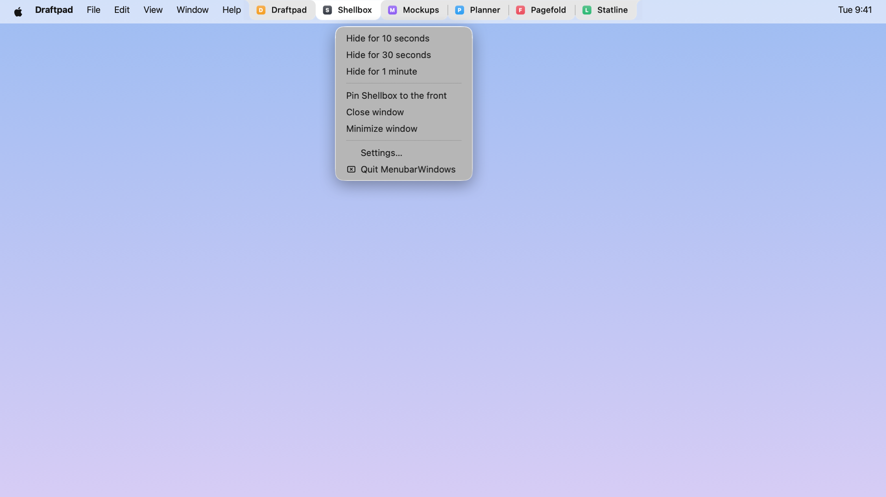
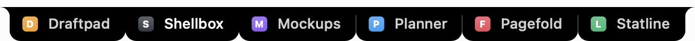
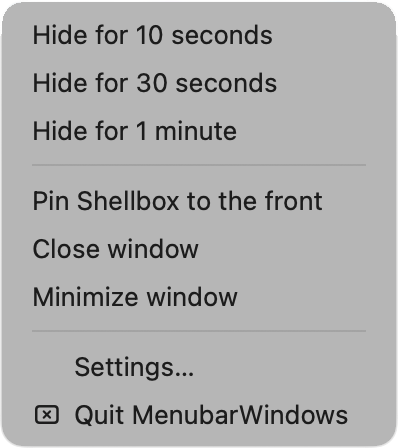
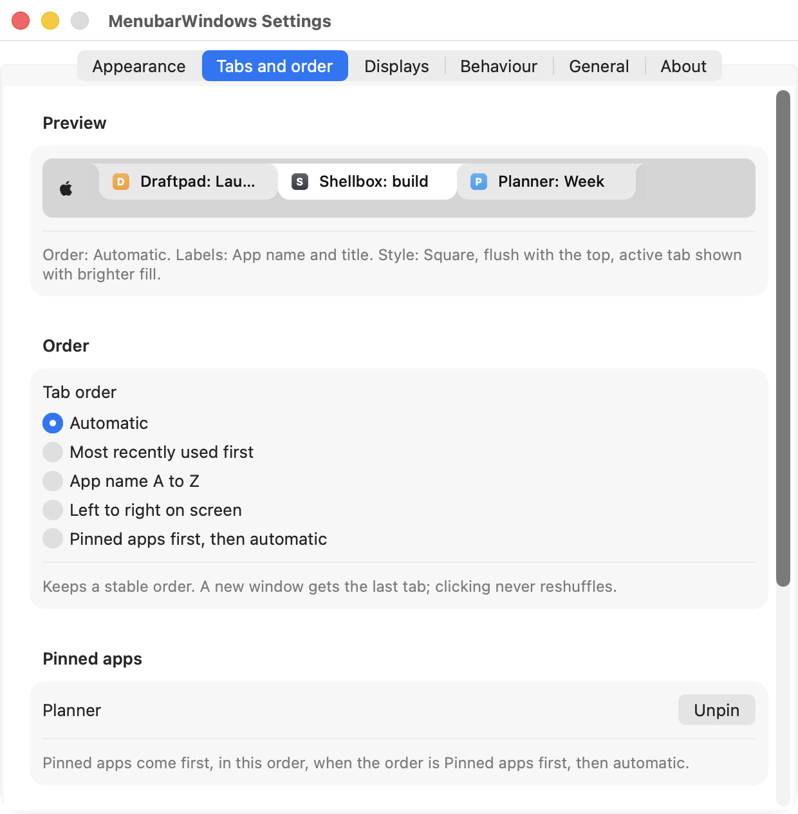
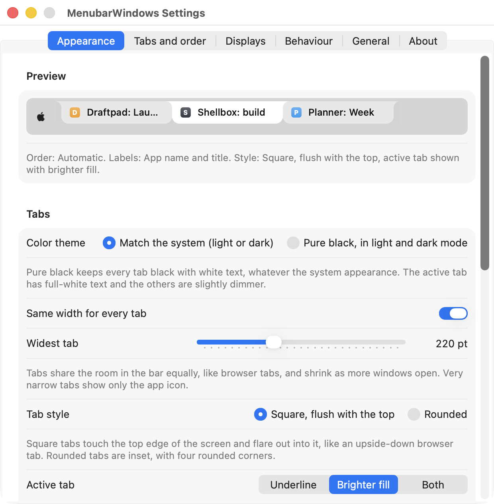
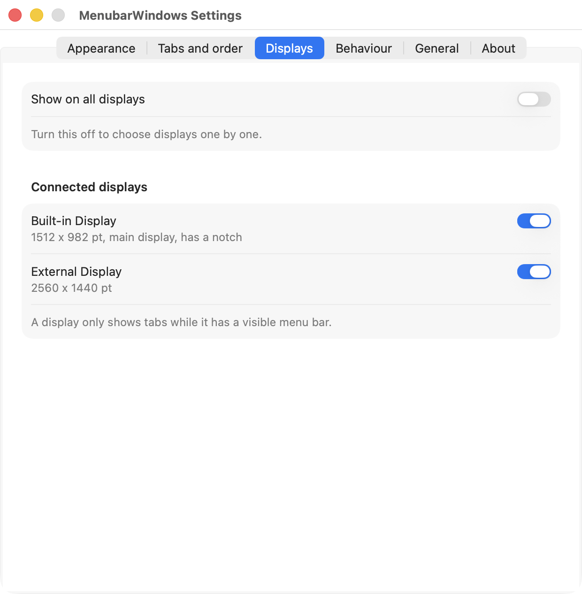
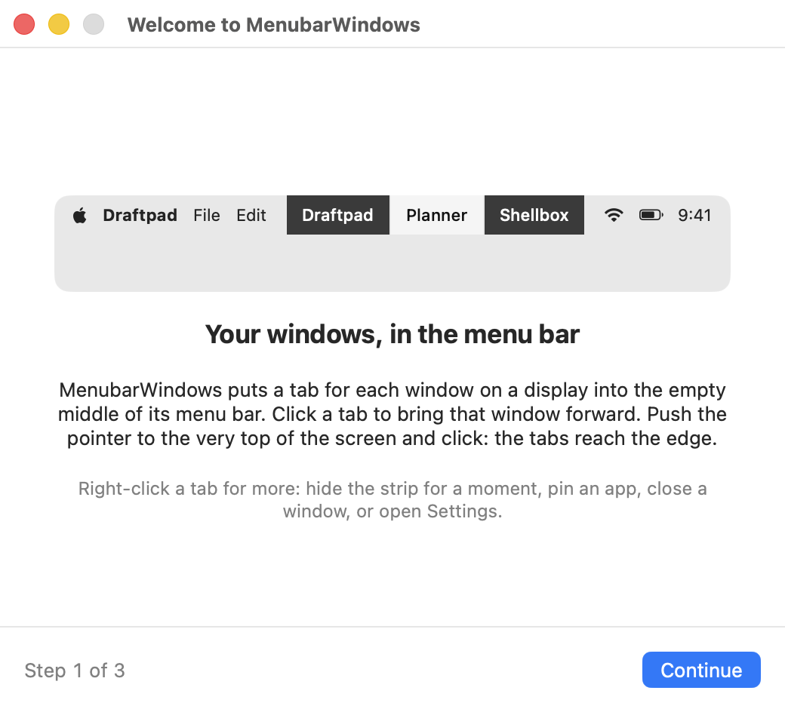
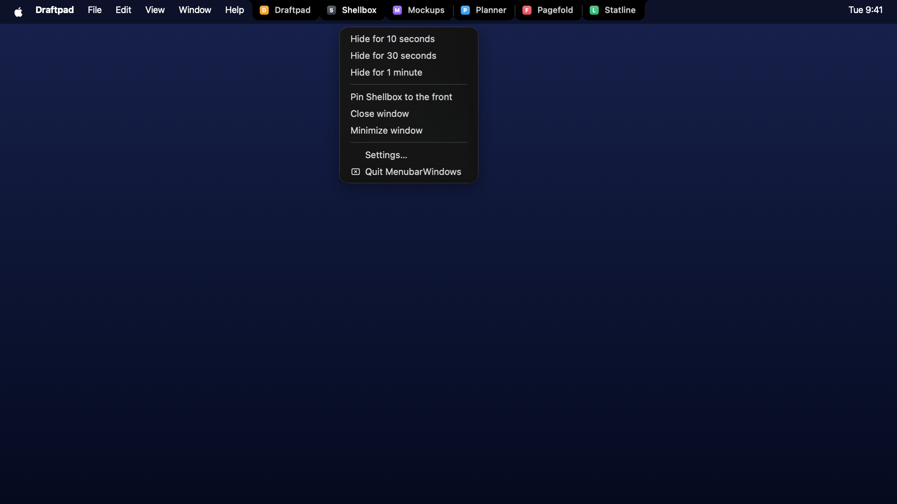

# MenubarWindows

Your windows, as tabs in the empty middle of the menu bar.



MenubarWindows is a small, free, open source macOS app (MIT) that draws a strip of window tabs **inside the
menu bar**, one tab per window on that display. Click a tab to bring its window forward. The tabs reach
the very top edge of the screen, so you can push the pointer up and click without aiming.

The product name, bundle identifier and tagline live in one place:
[`Sources/MenubarWindows/AppInfo.swift`](Sources/MenubarWindows/AppInfo.swift). The scripts read them
from there (`scripts/app-info.sh`), and the version comes from [`VERSION`](VERSION).

## Screenshots

All images are captured from the real app in demo mode: the apps and windows are invented (see
[Screenshots and demo mode](#screenshots-and-demo-mode)). The menu bar around the strip in the two hero
images is drawn.

**Light and pure black**




**Many windows: tabs shrink to icons**


**Right-click a tab**



**Settings**

| | |
| --- | --- |
|  |  |
| Tabs and order: five tab orders, pinning | Appearance: theme, tab style, width, height |
|  |  |
| Displays: choose where tabs appear | First-run guide for the Accessibility permission |

**Pure black desktop**



More in [`assets/screenshots/`](assets/screenshots/): `strip-three.png`, `strip-menu.png`,
`context-menu-dark.png`, `order-picker.png` and the other Settings panes.

## Features

- Tabs live in the unused middle of the menu bar, left of the status icons, on every display that shows
  a menu bar.
- Handles the notch: on notched screens the strip ends just left of it.
- Clicks land at the very top pixel row: the panel extends 6pt above the screen edge.
- Stays clear of status icons, and leaves the Apple menu and the app name usable.
- Five tab orders, pinning, four label modes, two tab styles, two color themes (match the system or
  Pure black), tab height, accent color, placement, width and alignment.
- The focused window's tab is marked active, also while a helper window such as a Find bar has focus.
  Every tab label has at least 4.5:1 contrast in light, dark and Pure black (checked by unit tests).
- Per-display on/off, hide on demand, hide in full screen, hide when only one window is open.
- Right-click a tab: hide for a few seconds, pin or unpin its app, close or minimize the window,
  Settings, Quit. Middle-click a tab to close its window.
- Light on resources: one 0.5s refresh timer and a 2s permission check, no background services. Measured
  on the development Mac with four windows: 0.7% CPU on average while idle (20-second `top` sample).
- No network access, no analytics. Nothing leaves your Mac.

## Settings

Open Settings by right-clicking any tab and choosing **Settings…**, or by opening the app again from
Finder or Spotlight (there is no Dock icon and no menu bar icon by design). Every change applies at once.

| Section | Options (default in bold) |
| --- | --- |
| Appearance | Tab style: **Square, flush with the top** or Rounded. Color theme: **Match the system** or Pure black. Tab height: 50 to 100% of the menu bar (**85%**). Same width for every tab: **on**, up to 220pt, sharing the room like browser tabs. Active tab: Underline, **Brighter fill**, Both. Accent: **system** or a custom color. Width: **Automatic (fit the tabs, up to a maximum)** or Fixed, 240 to 900pt (**560**). Alignment: **Center** or Left. Placement: **Middle of the menu bar** or Top left, right after the Apple menu. Live preview. |
| Tabs and order | Order (see below, **Automatic**). Pinned apps list. Labels: App name, Window title, **App name and title**, Icon only. **Shrink to icon-only when crowded**. Show up to 3 to 12 tabs (**8**); the rest go in a **+N** tab that opens a menu. Live preview. |
| Displays | **Show on all displays**, or a toggle per connected display (stored by display UUID). |
| Behaviour | Hide when only one window is open (off). **Hide in full-screen apps**. Include minimized windows (off; they show with a dimmed icon). **Ignore small helper windows** smaller than **100pt** (also drops windows the app marks with a non-standard AX subrole, such as Edge's Find bar). Hide-for durations (**10, 30, 60** seconds). |
| General | Launch at login (SMAppService; only from the .app bundle). **Show Settings when the app is opened again**. Accessibility status and setup guide. |
| About | Version, tagline, privacy note, Reset to defaults. |

### Tab order modes

1. **Automatic**: a stable first-seen order. A new window gets the last tab. Clicking never reshuffles.
2. **Most recently used first**: the window you used last comes first.
3. **App name A to Z**: by app name; windows of one app keep their automatic order.
4. **Left to right on screen**: by each window's left edge, higher windows first on a tie.
5. **Pinned apps first, then automatic**: pinned apps in pin order, then everything else.
   Pin from a tab's right-click menu. Pinning while in another mode switches to this one.

Ordering is a pure function in `Sources/MenubarWindowsCore/TabOrdering.swift` with unit tests.

## Install

Not published yet. When it is, the plan is:

```
brew install --cask jovylle/tap/menubarwindows
```

or download the dmg from the GitHub release and drag the app to Applications. The cask, the release
script and the steps to publish a tap are in `packaging/homebrew/`. Building from source is below.

## Build and run

Requirements: macOS 13 or later, Swift 6 toolchain (Command Line Tools are enough). No third-party
dependencies, and nothing is downloaded at build time.

```sh
swift run -c release              # quick run; Accessibility is granted to your terminal
./scripts/test.sh                 # unit tests (Swift Testing), offline
./scripts/build-app.sh            # build/MenubarWindows.app, ad-hoc signed
./scripts/make-dmg.sh             # build/MenubarWindows-<version>.dmg with an Applications shortcut
./scripts/make-icon.sh            # only when the icon design changes; output is committed in Resources/
```

`scripts/test.sh` exists because, with only the Command Line Tools selected, SwiftPM does not find the
bundled Swift Testing framework by itself; the script passes its paths. With Xcode selected, plain
`swift test` works too.

Headless check (no UI), for the bare binary or the bundle:

```sh
.build/release/MenubarWindows --version
.build/release/MenubarWindows --list
build/MenubarWindows.app/Contents/MacOS/MenubarWindows --list
```

It prints the active tab order and filters, and per screen the strip region and the windows in tab
order. Any setting can be overridden for one run with a launch argument, for example
`-mw.order recentFirst` or `-mw.hasCompletedOnboarding YES`. For testing colors without changing the system
appearance, `-mw.debugAppearance dark` (or `light`) forces an appearance for one run.

The bare binary and the bundle keep separate settings: the defaults domain is the executable name for
`swift run` and the bundle identifier for the app.

## Screenshots and demo mode

`-mw.demo YES` replaces the real windows with invented ones (Draftpad, Shellbox, Mockups, Planner,
Pagefold, Statline, Tunebox, Inkwell) with icons drawn in code, so a screenshot or video never shows your
own apps. These are debug launch arguments; they are not in the Settings window.

| Argument | Effect |
| --- | --- |
| `-mw.demo YES` | Fake windows, fake display names in Settings, Displays, permission shown as granted. Clicking a fake tab only moves the active marker; close, minimize and middle-click do nothing. |
| `-mw.demoCount <n>` | 1 to 8 fake windows (default 6). |
| `-mw.demoActive <index>` | Which fake tab is focused, from 0 (default 1). |
| `-mw.demoMenu <index>` | Opens that tab's right-click menu about a second after launch. |
| `-mw.demoBackdrop YES` | A plain dark blue window right behind the strip, owned by the app, so the real menu bar is covered. |
| `-mw.openSettings YES` | Opens Settings at launch (also without demo mode). |
| `-mw.settingsPane <name>` | `appearance`, `tabs`, `displays`, `behaviour`, `general` or `about`. |
| `-mw.showOnboarding YES` | Opens the first-run guide at launch (also without demo mode). |

Demo mode keeps its settings in a separate suite (`MenubarWindows.demo`) that is emptied at every demo
launch, so it never changes your real settings. Other `-mw.` arguments still apply, for example
`-mw.colorTheme black`. Fake windows only go to the first display's strip. In an unbundled build, demo
mode shows the icon from `Resources/` and the version from `VERSION` in About.

To capture everything again:

```sh
swift build -c release
./scripts/capture-screenshots.sh
```

The script launches `.build/release/MenubarWindows` once per shot (about three seconds each, around a
minute in total), captures only that process's own windows with `screencapture -l <windowID> -o`, and
quits only that process. Window IDs come from CGWindowList filtered by the launched process ID, so
another running copy of the app is never captured. It writes `assets/screenshots/`, composes the two
hero images with `scripts/screenshot-tool.swift` (CoreGraphics, no dependencies), and copies four images
to `site/assets/`. Settings shots are retaken when the window was not active. Look at every image before
committing it.

## Private files in a public repo

Anything you want to keep private (launch notes, signing steps, contact details) goes in `private/`.
That folder and `.vault-key` are gitignored. `node scripts/vault.mjs encrypt` writes each file as
AES-256-GCM ciphertext into `private.enc/`, which is committed. `node scripts/vault.mjs decrypt` on
another checkout restores them, given the same key.

- `init` creates the key once and never replaces it. Back it up outside this repo, for example in a
  password manager. Without it the encrypted files cannot be recovered. CI or another machine can pass it
  as `MWVAULT_KEY` (64 hex characters) instead of the file.
- `encrypt` skips unchanged files and refuses to overwrite ciphertext that does not open with the current
  key (pass `--force` to override). Each file is bound to its path, so swapping two files makes decryption
  fail.
- `status` shows what is not encrypted yet. `check` fails if plaintext or the key is tracked by git.
- Enable the guard once per clone: `git config core.hooksPath scripts/hooks`.
- Tests: `node --test Tests/vault.test.mjs`.

Ciphertext in a public repo stays public forever, so a leaked key exposes every past version of every
file. Treat the key like a password and rotate it by re-encrypting with `--force` if it leaks.

## Permissions

The app reads window titles, focus and positions through the **Accessibility** API. It does **not** use
Screen Recording.

On first launch, and whenever access is missing, a short guide explains what the app does and why it
needs access, opens **System Settings → Privacy & Security → Accessibility**, and shows a live status that
flips to granted by itself. If you close the guide, a **Grant Accessibility access** tab stays in the menu
bar; click it to reopen the guide.

For `swift run`, macOS grants access to the terminal app, and everything run from that terminal gets it
too. Use a binary you trust.

## Privacy

MenubarWindows makes no network connections, has no analytics, no crash reporting and no update check.
Window titles are read in memory to draw tabs and are never stored or sent anywhere. Settings are stored
in the app's own `UserDefaults`.

## Known limits

- **Not sandboxable, so not on the App Store.** It needs the Accessibility API and the private
  `_AXUIElementGetWindow` (to map AX windows to CG window IDs without Screen Recording). If that symbol
  stops working, matching falls back to window bounds within 2pt.
- **Menu bar auto-hide:** when the system reserves no menu bar and no app menu titles are seen on a
  display, that display gets no strip.
- **Full screen:** detection is a best-effort check of `AXFullScreen` on the frontmost window.
- **Notch:** the strip is limited to the area left of the notch. If too little room is left, it hides.
- **The strip may cover the frontmost app's menu titles** in the middle of the bar. Right-click a tab and
  use **Hide for …** to reach them.
- **Empty strip space is not click-through.** In Automatic width the strip is trimmed to the tabs, so this
  only matters with a fixed width.
- **Windows on other Spaces** do not get a tab (they are not on screen), but they keep their slot in the
  automatic order when they come back.
- **Include minimized windows** asks every regular app for its windows on each refresh, which costs a
  little more.
- Not verified interactively for every option: see CHANGELOG for what was checked.

## Release checklist (not done yet)

The beta build is ad-hoc signed, which only runs without warnings on the Mac that built it. Distribution
to other Macs needs an Apple Developer ID certificate and notarization. These commands are documented
here and were **not** run:

```sh
# 1. Sign with hardened runtime and a Developer ID Application certificate.
codesign --force --deep --options runtime --timestamp \
  --sign "Developer ID Application: <Name> (<TEAMID>)" build/MenubarWindows.app
codesign --verify --deep --strict --verbose=2 build/MenubarWindows.app

# 2. Build the dmg, sign it, and submit it for notarization.
./scripts/make-dmg.sh
codesign --sign "Developer ID Application: <Name> (<TEAMID>)" --timestamp build/MenubarWindows-<version>.dmg
xcrun notarytool submit build/MenubarWindows-<version>.dmg \
  --keychain-profile "<notary-profile>" --wait

# 3. Staple the ticket and check Gatekeeper.
xcrun stapler staple build/MenubarWindows-<version>.dmg
spctl --assess --type open --context context:primary-signature -v build/MenubarWindows-<version>.dmg
```

Also before a public release: bump `VERSION`, update `CHANGELOG.md`, and publish the site.

## Project layout

```
Package.swift
VERSION                          app version (read by build-app.sh)
Resources/                       AppIcon.icns, AppIcon-1024.png (generated, committed)
Sources/MenubarWindowsCore/
  TabOrdering.swift              order modes, ordering function, first-seen and MRU tracker
  TabLabel.swift                 label modes and label text
  FocusMatch.swift               which tab is active (focused, else main window, timeout rule)
  TabPalette.swift               tab colors per theme and state, WCAG contrast
  WindowFilterRule.swift         helper-window filter by size and AX subrole
  DemoData.swift                 invented windows, apps and displays for demo mode
Sources/MenubarWindows/
  AppInfo.swift                  display name, bundle id, tagline (single source)
  main.swift                     entry point, --version, --list
  AppDelegate.swift              panels per screen, refresh loop, permission poll, tab actions
  Settings.swift                 typed UserDefaults settings, live change publisher, display ids
  SettingsView.swift             SwiftUI Settings window
  StripPreview.swift             live preview built from the real strip and pill views
  OnboardingView.swift           three-step first-launch and permission guide
  WindowControllers.swift        NSWindow hosting, Launch at login, Accessibility request
  StripPanel.swift               the panel and strip view (layout, scroll, menus, +N tab)
  PillView.swift                 one tab (icon, label, style, active indicator, clicks)
  MenuBarGeometry.swift          strip region, notch, status icons, coordinate conversion
  WindowProvider.swift           CG window list merged with AX titles, focus and filters
  WindowRaiser.swift             raise, close and minimize through AX
  AccessibilityHelpers.swift     AX wrappers and _AXUIElementGetWindow
  ListCommand.swift              --list output
  DemoMode.swift                 demo mode: fake windows and icons, backdrop, launch-only flags
Tests/MenubarWindowsCoreTests/   ordering, label, active tab, contrast, filter and demo data tests
scripts/                         app-info.sh, build-app.sh, make-dmg.sh, make-icon.sh(+.swift), test.sh,
                                 capture-screenshots.sh and screenshot-tool.swift
assets/screenshots/              screenshots captured in demo mode
site/                            landing page (static, offline)
```
